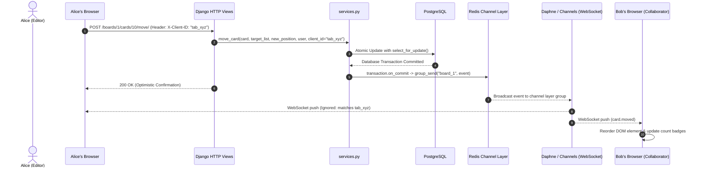

# TaskFlow — Real-time Collaborative Task Board (Trello-Lite)

> **Phase 4: Activity Log, Card Comments with @Mentions, Live Presence & In-App Notifications**

TaskFlow is a collaborative Kanban task board built with Python 3.12+ and Django 5.x on top of PostgreSQL, with live real-time sync powered by Django Channels and Redis.

In **Phases 1, 2, 3 & 4**, the project establishes:
- Secure authentication with a custom User model (equipped with `avatar_color` for live presence).
- Relational schema with role-based access control (RBAC): `Board`, `BoardMembership`, `BoardList`, `Card`, `Activity`, `Comment`, and `Notification`.
- Centralized access control returning `404 Not Found` for non-members to prevent workspace enumeration.
- Board workspace CRUD, member invitations, role promotions, and member removals restricted to workspace `OWNER`.
- **Dedicated business logic service layer** (`boards/services.py`) encapsulating all mutations with `select_for_update()` concurrency locks.
- **Contiguous integer sequence ordering** with automatic gap closure and renumbering.
- **Dynamic drag-and-drop** with vendored SortableJS for horizontal column reordering and cross-column card moves.
- **Live real-time multiplayer synchronization** via Django Channels WebSockets (`ws/boards/<id>/`).
- **One validated write path (CQRS pattern):** Mutations flow via HTTP POST endpoints; WebSockets push real-time event deltas.
- **`transaction.on_commit` broadcast guarantees:** Clients never receive ghost events for rolled-back transactions.
- **Client-side echo cancellation & collision handling** via ephemeral tab `client_id` and active drag queueing.
- **Automatic reconnect with exponential backoff & snapshot state reconciliation.**
- **Real-time membership lifecycle updates:** Role demotions and member removals update or kick clients live.
- **Immutable audit activity log** recorded in same-transaction writes with frozen write-time summaries and cursor-based pagination.
- **Card comment discussion threads** with chronological ordering, card badge counters, and strict XSS prevention (`textContent`).
- **Regex @mention extraction & in-app notifications** delivered over private user WebSockets (`ws/notifications/`) to an interactive navbar bell.
- **Live board presence tracking** powered by Redis sorted sets with 60s stale pruning, 20s client heartbeats, and multi-tab deduplication.
- **Zero N+1 database queries:** Board detail page optimized to exactly 7 total queries ($O(1)$ query scaling).
- **Redis channel layer with zero-setup in-memory fallback** and broker outage resilience.
- Django Admin with inline models for convenient entity inspection.
- A comprehensive `seed_demo` management command for instant local testing.

---

## 🚀 Quickstart Setup

### 1. Prerequisites
- **Python 3.12+**
- **PostgreSQL** running locally on port 5432 (or use SQLite fallback if desired)

### 2. Virtual Environment & Dependencies
```bash
# Navigate to project directory
cd taskflow

# Create and activate virtual environment
python -m venv venv
.\venv\Scripts\activate   # On Windows PowerShell / CMD
# or source venv/bin/activate on macOS/Linux

# Install pinned dependencies
pip install -r requirements.txt
```

### 3. Environment Variables
Copy `.env.example` to `.env` and verify your PostgreSQL credentials:
```bash
cp .env.example .env
```

Your `.env` file contains:
```env
SECRET_KEY=django-insecure-taskflow-dev-secret-key-phase1-super-secure
DEBUG=True
ALLOWED_HOSTS=127.0.0.1,localhost

# Database Configuration (PostgreSQL)
DB_ENGINE=django.db.backends.postgresql
DB_NAME=taskflow
DB_USER=postgres
DB_PASSWORD=root
DB_HOST=localhost
DB_PORT=5432

# Or toggle SQLite for instant zero-dependency testing:
USE_SQLITE=False
```

### 4. Database Setup & Migrations
Ensure the `taskflow` database exists in PostgreSQL (or create it: `CREATE DATABASE taskflow;`), then apply migrations:
```bash
python manage.py migrate
```

### 5. Seed Demo Data
Populate the database with 3 demo users, 1 board workspace, 3 columns, and 8 sample task cards:
```bash
python manage.py seed_demo
```

**Seeded Demo Credentials** (all use password: `password123`):
- `alice` &mdash; Role: **OWNER** (full workspace management, invites, deletes)
- `bob` &mdash; Role: **EDITOR** (member with edit privileges)
- `charlie` &mdash; Role: **VIEWER** (read-only member)

*(An admin superuser `admin` / `admin123` is also available for accessing `/admin/`)*.

### 6. Run the Development Server
```bash
python manage.py runserver
```
Visit: [http://127.0.0.1:8000/](http://127.0.0.1:8000/)

---

## 📁 Project Structure

```
taskflow/
├── manage.py
├── requirements.txt            # Pinned Django 5.x, psycopg 3, python-decouple
├── .env.example                # Example environment file
├── .env                        # Local environment variables
├── .gitignore                  # Python, Django, venv, and DB ignore rules
├── taskflow/                   # Core project configuration
│   ├── __init__.py
│   ├── settings.py             # Decouple-driven settings, custom AUTH_USER_MODEL
│   ├── urls.py                 # Top-level routing: accounts/, boards/, admin/
│   ├── wsgi.py
│   └── asgi.py
├── accounts/                   # Authentication & user profile app
│   ├── models.py               # Custom User extending AbstractUser (avatar_color)
│   ├── forms.py                # SignUpForm with color picker widget
│   ├── views.py                # SignUpView with automatic post-registration login
│   ├── urls.py                 # /accounts/login/, /accounts/signup/, /accounts/logout/
│   ├── admin.py                # UserAdmin with avatar_color in fieldsets
│   └── tests.py                # User creation and auth flow tests
├── boards/                     # Workspace, membership & Kanban models
│   ├── models.py               # Board, BoardMembership, BoardList, Card
│   ├── permissions.py          # Centralized get_board_for_member & BoardAccessMixin
│   ├── forms.py                # BoardForm, AddMemberForm, UpdateMemberRoleForm
│   ├── views.py                # MyBoards, Create, Detail, Edit, Delete, ManageMembers
│   ├── urls.py                 # Workspace routes
│   ├── admin.py                # Inlines: BoardMembershipInline, BoardListInline, CardInline
│   ├── tests.py                # Access control & CRUD unit tests
│   └── management/
│       └── commands/
│           └── seed_demo.py    # Seed demo users, boards, lists, and cards
├── static/
│   └── css/
│       └── style.css           # Vanilla CSS modern design system
└── templates/
    ├── base.html               # Base layout with navbar, avatar badges, alerts
    ├── accounts/
    │   ├── login.html          # Login card with demo credential quick-hints
    │   └── signup.html         # Signup card with avatar color picker
    └── boards/
        ├── my_boards.html      # User's boards dashboard showing roles
        ├── board_create.html   # Board creation form
        ├── board_detail.html   # Workspace columns & cards read-only view
        ├── board_edit.html     # Owner edit board form
        ├── board_confirm_delete.html # Owner delete confirmation
        └── manage_members.html # Owner member roster, invites, role changes & removal
```

---

## 🧠 Database Schema & Architectural Explanations

Each model was designed specifically to support interview discussions regarding scalability, clean relational design, and security:

### 1. `accounts.User` (`AbstractUser`)
- **Why extend `AbstractUser` on migration 0001?**
  Django's default auth model is notoriously difficult to substitute once foreign keys have been registered across a project. Defining a custom user model upfront avoids migration deadlocks and provides flexibility to add features like `avatar_color` and future profile or OAuth fields without database surgery.
- **`avatar_color` (`CharField(max_length=7)`):**
  Stores a hex color string (e.g. `#4F46E5`). In Phase 1, it provides a distinctive colored avatar bubble in the navbar and on cards. In Phase 3 (WebSockets), it will power real-time cursor/presence indicators.

### 2. `boards.Board`
- **Role:** High-level collaborative workspace entity.
- **Fields:**
  - `title`: Name of the board workspace.
  - `description`: Context and workspace objectives.
  - `owner`: Foreign key to `User`. The board creator who retains final authority (board deletion, owner cannot be demoted).
  - `created_at` & `updated_at`: Timestamps for auditability and sorting.
- **Optimization:** Indexed on `owner` and `created_at`. Ordered by `['-updated_at']` so recently active boards surface first.

### 3. `boards.BoardMembership` (RBAC Join Table)
- **Role:** Explicit join table modeling the Many-to-Many relationship between `Board` and `User`.
- **Why an explicit through model instead of `ManyToManyField`?**
  An explicit through model allows storing critical relational metadata on the edge itself: the member's `role` (`OWNER`, `EDITOR`, `VIEWER`) and `joined_at` timestamp.
- **Constraints & Indexes:**
  - `UniqueConstraint(fields=['board', 'user'])`: Prevents duplicate memberships at the database level.
  - Composite index on `(board, user)`: Makes permission lookups on every request $O(1)$ fast.
  - Index on `user`: Enables instant querying of all boards a user belongs to for the "My Boards" dashboard.

### 4. `boards.BoardList`
- **Role:** Workflow columns within a board (e.g. "To Do", "In Progress", "Done").
- **Why named `BoardList`?**
  Prevents shadowing Python's built-in `list` primitive.
- **`position` (`PositiveIntegerField`):**
  Enables explicit arbitrary sequencing from left to right. This decouples visual column order from insertion primary keys, making drag-and-drop column reordering trivial in later phases.
- **Optimization:** Indexed on `(board, position)` and ordered by `['position', 'created_at']`.

### 5. `boards.Card`
- **Role:** Discrete task items nested inside a `BoardList`.
- **`position` (`PositiveIntegerField`):**
  Enables vertical ordering within a column.
- **`created_by` (`ForeignKey(User)`):**
  Preserves authorship and task provenance regardless of who edits or drags the card across columns.
- **Optimization:** Indexed on `(board_list, position)` and ordered by `['position', 'created_at']`.

---

## 🛡️ Security & Access Control

### Centralized Permission Layer (`boards/permissions.py`)
All authorization checks are consolidated in `get_board_for_member` and `BoardAccessMixin`:
1. **Preventing Workspace Enumeration (404 vs 403):**
   When a user requests a board they are not a member of (e.g., `/boards/999/`), TaskFlow raises **`Http404`** rather than `Http403`. Returning `403 Forbidden` would confirm to unauthorized users that a board ID exists, exposing private organizational boards to ID enumeration attacks.
2. **Owner-Only Enforcement:**
   Views modifying workspace metadata (`BoardUpdateView`, `BoardDeleteView`, `BoardMembersView`) inherit from `BoardOwnerRequiredMixin`. Non-members receive `404`, and non-owner members receive `403 PermissionDenied`.
3. **Owner Invariant Protection:**
   The board owner cannot be removed or demoted from the workspace, preventing orphaned boards.

---

## ⚡ Phase 2: Interactive Kanban, Service Layer & Ordering Engine

### 1. Business Logic Service Layer (`boards/services.py`)
To maintain separation of concerns and prepare for WebSocket broadcasts in Phase 3, all mutation operations are isolated into pure service functions:

| Service Function | Responsibility | Return Value |
| :--- | :--- | :--- |
| `create_list(board, title, user)` | Appends column at end (`position = count`) | Created `BoardList` |
| `rename_list(board_list, new_title, user)` | Updates column header title | Updated `BoardList` |
| `delete_list(board_list, user)` | Cascades cards and renumbers remaining columns | `None` |
| `move_list(board_list, new_position, user)` | Reorders column within board; renumbers siblings | Updated `BoardList` |
| `create_card(board_list, title, description, user)` | Appends card at bottom of column (`position = count`) | Created `Card` |
| `update_card(card, title, description, user)` | Modifies task card title/description | Updated `Card` |
| `delete_card(card, user)` | Deletes card and renumbers list to close gap | `None` |
| `move_card(card, target_list, new_position, user)` | Moves card within list or across columns with renumbering | Updated `Card` |

Views act purely as thin HTTP/JSON adapters, delegating all domain logic and validation to this module.

### 2. Ordering Strategy & Tradeoff Analysis

TaskFlow uses **Contiguous Integer Sequence Positioning** (`0, 1, 2, ... N-1`):

* **How It Works:**
  1. Moving an item removes it from its current position, closing the sequence gap.
  2. The item is inserted at the desired destination index.
  3. Neighboring rows are renumbered so indices remain contiguous zero-indexed integers without holes or duplicates.

* **Tradeoff Comparison:**

| Strategy | Pros | Cons / Tradeoffs | Decision in TaskFlow |
| :--- | :--- | :--- | :--- |
| **Contiguous Integers** *(Selected)* | Deterministic sorting, human-readable, zero risk of precision exhaustion, zero database bloat | Requires $O(N)$ write updates on adjacent rows during moves | **Adopted**: Columns rarely exceed 50–100 cards; indexed updates execute in <5ms inside transactions |
| **Fractional / Float Indexing** | Single-row update ($O(1)$) by taking midpoint $(a + b) / 2$ | Rapidly collapses due to IEEE 754 precision exhaustion; requires background rebalancing jobs | **Rejected**: High complexity and precision failure risks |
| **LexoRank / String Keys** | Single-row update using alphanumeric midpoint strings | String storage overhead, complex boundary generation, eventual string bloat | **Rejected**: Overkill for Kanban workload |

* **Race Condition Protection:**
  Multi-row renumbering is locked using `transaction.atomic()` and `select_for_update()`. This serializes concurrent drag-and-drop operations, preventing sequence duplication or interleaving.

### 3. Drag-and-Drop Implementation
* **Library:** [SortableJS](https://github.com/SortableJS/Sortable) vendored directly into `static/vendor/sortable.min.js`.
* **Why Vendored?** Eliminates CDN latency, provides offline resilience, and prevents external CDN outages from breaking internal workflows.
* **Optimistic UI with Rollback:** On drop, the DOM changes immediately. If the server rejects the request (e.g. permission error, session timeout), the script catches the failure, reverts the DOM element back to its original parent and position, and displays an informative toast notification.

### 4. RESTful JSON Mutation Endpoints

All endpoints require CSRF authentication and accept HTTP `POST`:

| Method | Endpoint URL | Input Payload | Status Codes | Description |
| :--- | :--- | :--- | :--- | :--- |
| `POST` | `/boards/<b_id>/lists/create/` | `{"title": "..."}` | 200, 400, 403, 404 | Appends a column |
| `POST` | `/boards/<b_id>/lists/<l_id>/rename/` | `{"title": "..."}` | 200, 400, 403, 404 | Renames a column |
| `POST` | `/boards/<b_id>/lists/<l_id>/delete/` | `{}` | 200, 403, 404 | Deletes column and its cards |
| `POST` | `/boards/<b_id>/lists/<l_id>/move/` | `{"new_position": 1}` | 200, 400, 403, 404 | Repositions a column |
| `POST` | `/boards/<b_id>/lists/<l_id>/cards/create/` | `{"title": "...", "description": "..."}` | 200, 400, 403, 404 | Appends a card |
| `POST` | `/boards/<b_id>/cards/<c_id>/update/` | `{"title": "...", "description": "..."}` | 200, 400, 403, 404 | Updates card title/desc |
| `POST` | `/boards/<b_id>/cards/<c_id>/delete/` | `{}` | 200, 403, 404 | Deletes card |
| `POST` | `/boards/<b_id>/cards/<c_id>/move/` | `{"target_list_id": 2, "new_position": 0}` | 200, 400, 403, 404 | Moves card within or across lists |
| `GET`  | `/boards/<b_id>/snapshot/` | N/A | 200, 404 | Returns full board state for reconnect reconciliation |

### 5. Role & Permission Matrix (Role $\times$ Action)

| Action | Workspace `OWNER` | `EDITOR` | `VIEWER` | Non-Member / Anonymous |
| :--- | :---: | :---: | :---: | :---: |
| **View Board & Cards** | ✅ Yes | ✅ Yes | ✅ Yes (Read-Only) | ❌ **404 Not Found** |
| **Create / Rename / Delete Lists** | ✅ Yes | ✅ Yes | ❌ **403 Forbidden** | ❌ **404 Not Found** |
| **Reorder Lists (Drag & Drop)** | ✅ Yes | ✅ Yes | ❌ **403 Forbidden** | ❌ **404 Not Found** |
| **Create / Update / Delete Cards** | ✅ Yes | ✅ Yes | ❌ **403 Forbidden** | ❌ **404 Not Found** |
| **Move Cards (Drag & Drop)** | ✅ Yes | ✅ Yes | ❌ **403 Forbidden** | ❌ **404 Not Found** |
| **Connect to WebSocket Live Sync** | ✅ Yes | ✅ Yes | ✅ Yes | ❌ **4404 / 4401 Closed** |
| **Manage Members (Add / Change Roles)**| ✅ Yes | ❌ **403 Forbidden** | ❌ **403 Forbidden** | ❌ **404 Not Found** |
| **Edit Board Metadata / Delete Board** | ✅ Yes | ❌ **403 Forbidden** | ❌ **403 Forbidden** | ❌ **404 Not Found** |

---

## 🌐 Phase 3: Real-Time Collaborative Architecture (WebSockets & Channels)

### 1. Architectural Philosophy: One Validated Write Path (CQRS)
* **The Design Decision:**
  All board state mutations (create, update, delete, move) flow strictly through the existing **HTTP POST endpoints and `boards/services.py`**. WebSockets are used **exclusively to push real-time event notifications** from server to clients.
* **Why this pattern?**
  1. **Centralized Command Validation:** Centralizes permissions, input sanitization, database transactions, row locking (`select_for_update`), and contiguous renumbering in `services.py`.
  2. **Security & Session Simplicity:** Leverages Django's mature CSRF protection, session management, and HTTP status codes (`400`, `403`, `404`) without re-inventing error protocols over WebSocket frames.
  3. **Guaranteed Delivery on Commit:** Broadcasters are executed within `transaction.on_commit()`. If an operation fails and rolls back in PostgreSQL, clients will never receive ghost events for state that never persisted.



### 2. Standardized Real-Time Event Schemas

All messages published to the `board_<board_id>` channel layer group adhere to a consistent envelope:

```json
{
  "event": "<event_type>",
  "payload": { ... },
  "board_id": 1,
  "actor_id": 1,
  "client_id": "tab_xyz"
}
```

| Event Type | Trigger | Payload Schema | Client Action |
| :--- | :--- | :--- | :--- |
| `list.created` | New column added | `{"list": {"id", "title", "position"}}` | Renders new column DOM element |
| `list.renamed` | Column title updated | `{"list": {"id", "title"}}` | Updates header title text |
| `list.deleted` | Column deleted | `{"list_id": int}` | Removes column DOM element |
| `list.moved` | Column repositioned | `{"list_id": int, "new_position": int}` | Repositions column in board track |
| `card.created` | New task card created | `{"card": {"id", "title", "description", "position", "list_id", "author", "author_initials", "author_color"}}` | Renders card in target list; updates counts |
| `card.updated` | Card title/description edited | `{"card": {"id", "title", "description"}}` | Updates card in DOM; live-updates edit modal if currently open |
| `card.deleted` | Task card deleted | `{"card_id": int, "list_id": int}` | Removes card DOM; closes edit modal if open with warning |
| `card.moved` | Card dragged/reordered | `{"card_id": int, "source_list_id": int, "target_list_id": int, "new_position": int}` | Repositions card in target list; recalculates indices |
| `card.assigned` | Card assignee updated | `{"card_id": int, "assignee": {"id", "username", "avatar_color", "initials"}}` | Updates card assignee badge and modal select |
| `comment.added` | New comment posted | `{"comment": {"id", "card_id", "author", "body", "created_at"}, "comments_count": int}` | Appends comment to modal thread; updates card badge |
| `comment.edited` | Comment body edited | `{"comment": {"id", "card_id", "body", "edited_at"}}` | Updates comment text and edited timestamp |
| `comment.deleted`| Comment removed | `{"comment_id": int, "card_id": int, "comments_count": int}` | Removes comment from thread; updates card badge |
| `activity.created`| Board mutation logged | `{"activity": {"id", "summary", "created_at", "actor": {"username", "avatar_color"}}}` | Prepends new activity item to slide-out drawer |
| `presence.changed`| Member joins/leaves/heartbeats | `{"users": [{"id", "username", "avatar_color", "initials"}]}` | Updates live presence avatar stack in board header |
| `member.role_changed` | Member role modified | `{"user_id": int, "new_role": str}` | Updates role badge; toggles drag/edit controls live |
| `member.removed` | Member kicked from board | `{"user_id": int}` | Closes WebSocket with code 4403; redirects user to `/boards/` |
| `board.deleted` | Board workspace deleted | `{"board_id": int}` | Closes WebSocket with code 4403; redirects all users to `/boards/` |

---

## 🔔 Phase 4: Activity Log, Card Comments, Live Presence & In-App Notifications

### 1. Immutable Activity Log Design & Cursor Pagination
* **Same-Transaction Audit Writes:**
  Every state-changing mutation in `boards/services.py` logs an `Activity` record within the exact same `transaction.atomic()` block via `boards/activity.py: log_activity()`. If any mutation fails or rolls back, zero orphan activity records are ever committed.
* **Write-Time Frozen Summaries:**
  The `summary` field is pre-rendered at the exact moment of the mutation (e.g., *"bob created card 'Write Docs'"*). If the card is subsequently renamed, moved, or deleted, past activity logs remain historically accurate and immutable.
* **Database Indexing:**
  The `Activity` model features a composite index on `(board, -created_at)` guaranteeing sub-millisecond retrieval without table scans.
* **Cursor-Based Pagination (`before_id`):**
  The activity drawer endpoint (`GET /boards/<id>/activity/?before_id=<id>&limit=20`) uses strict cursor-based pagination on primary keys (`id < before_id`). Unlike offset-based pagination (`OFFSET N`), cursor pagination is immune to duplicate or skipped entries when new events are continuously prepended.
* **Live Push Dispatch:**
  When a transaction commits, `log_activity` triggers `broadcast(board.id, 'activity.created', ...)` via `transaction.on_commit()`, streaming newly logged activities directly into all active drawer views.

### 2. Card Comments, Threading & @Mention Engine
* **Modal Discussion Thread:**
  Opening any card reveals its comment thread sorted in chronological order (oldest first).
* **Regex @Mention Extraction:**
  When a comment is created via `services.add_comment()`, a regular expression parses all `@username` mentions:
  ```python
  pattern = r"(?<!\w)@([a-zA-Z0-9_.+-]+)"
  ```
  - Mentions are filtered against **active board members only**.
  - Non-members mentioned in text are silently ignored.
  - Self-mentions by the comment author do not generate notifications.
  - Valid mentions generate a `Notification` record and immediately push a live WebSocket notification to the mentioned user.
* **Comment Permissions:**
  - `OWNER` & `EDITOR`: Can create comments on any card.
  - `VIEWER`: Read-only access; commenting endpoints reject viewers with `403 Forbidden`.
  - **Editing:** Strictly restricted to the original comment author (`comment.author == request.user`).
  - **Deletion:** Allowed for either the comment author OR the workspace `OWNER`.
* **Zero XSS Guarantee:**
  All comment bodies, activity summaries, and usernames are inserted into the DOM strictly via `textContent` or text node instantiation, entirely eliminating XSS vectors.

### 3. In-App Notification System & Real-Time Delivery
* **Data Model & Performance:**
  The `Notification` model tracks `recipient`, `actor`, `board`, `card`, `kind` (`mention` / `assigned`), and `is_read`. It is indexed on `(recipient, is_read, -created_at)` for instant unread query execution.
* **User-Dedicated WebSocket Channel:**
  Clients establish a dedicated notification connection to `ws/notifications/`. `NotificationConsumer` authenticates the user and joins the personal group `user_<user_id>`. When a notification is generated anywhere across any board, it is delivered exclusively to that user's private channel.
* **Navbar Bell & Live Counter:**
  The navbar features an interactive bell icon with a live unread badge. Clicking the bell displays a dropdown with unread and recent notifications, with actions to mark individual notifications read or mark all read.
* **Card Assignment Flow:**
  Assigning a member to a card via `services.assign_card()` updates `Card.assignee`, logs an activity record, dispatches a `card.assigned` event to the board, and dispatches an `assigned` notification to the assignee's personal channel.

### 4. Live Board Presence Tracking (Redis Sorted Sets)
* **High-Throughput In-Memory Storage:**
  Presence is stored in Redis sorted sets rather than PostgreSQL, preventing unnecessary database write amplification:
  - **Key Format:** `presence:board:<board_id>`
  - **Member Format:** `<user_id>:<channel_name>` (uniquely identifies a specific WebSocket connection)
  - **Score:** Current Unix timestamp (`time.time()`)
* **Lifecycle & Stale Pruning:**
  - **Connect:** Adds the connection member and score; prunes scores older than 60 seconds (`ZREMRANGEBYSCORE`).
  - **Heartbeat:** Clients send keepalive pings every 20 seconds, updating the score in Redis.
  - **Disconnect:** Explicitly removes the connection member on socket teardown.
  - **Key TTL:** A 2-hour TTL is maintained on presence keys (`EXPIRE`) to prevent orphaned keys if a board is abandoned.
* **Multi-Tab Deduplication:**
  If a user opens the same board across 3 tabs, all 3 channel names are tracked in Redis, but `get_board_presence()` groups them by `user_id`, rendering a single avatar in the board header.
* **Broker Fault Tolerance & Test Isolation:**
  If Redis is down or unreachable, presence calls gracefully degrade, returning an empty presence list without crashing the board. When running automated test suites or using `USE_IN_MEMORY_CHANNEL_LAYER=True`, presence seamlessly uses a thread-safe in-memory dictionary.

### 5. Role & Permission Matrix (Phases 1 – 4)

| Action | Workspace `OWNER` | `EDITOR` | `VIEWER` | Non-Member / Anonymous |
| :--- | :---: | :---: | :---: | :---: |
| **View Board, Lists & Cards** | ✅ Yes | ✅ Yes | ✅ Yes (Read-Only) | ❌ **404 Not Found** |
| **Create / Rename / Delete Lists** | ✅ Yes | ✅ Yes | ❌ **403 Forbidden** | ❌ **404 Not Found** |
| **Reorder Lists (Drag & Drop)** | ✅ Yes | ✅ Yes | ❌ **403 Forbidden** | ❌ **404 Not Found** |
| **Create / Update / Delete Cards** | ✅ Yes | ✅ Yes | ❌ **403 Forbidden** | ❌ **404 Not Found** |
| **Move Cards (Drag & Drop)** | ✅ Yes | ✅ Yes | ❌ **403 Forbidden** | ❌ **404 Not Found** |
| **Assign Member to Card** | ✅ Yes | ✅ Yes | ❌ **403 Forbidden** | ❌ **404 Not Found** |
| **Post Comments & @Mentions** | ✅ Yes | ✅ Yes | ❌ **403 Forbidden** | ❌ **404 Not Found** |
| **Edit Own Comment** | ✅ Yes | ✅ Yes | ❌ **403 Forbidden** | ❌ **404 Not Found** |
| **Edit Others' Comments** | ❌ **403 Forbidden** | ❌ **403 Forbidden** | ❌ **403 Forbidden** | ❌ **404 Not Found** |
| **Delete Own Comment** | ✅ Yes | ✅ Yes | ❌ **403 Forbidden** | ❌ **404 Not Found** |
| **Delete Others' Comments** | ✅ Yes | ❌ **403 Forbidden** | ❌ **403 Forbidden** | ❌ **404 Not Found** |
| **View Activity Log & Presence** | ✅ Yes | ✅ Yes | ✅ Yes | ❌ **404 Not Found** |
| **Manage Members (Add / Change Roles)**| ✅ Yes | ❌ **403 Forbidden** | ❌ **403 Forbidden** | ❌ **404 Not Found** |
| **Edit Metadata / Delete Board** | ✅ Yes | ❌ **403 Forbidden** | ❌ **403 Forbidden** | ❌ **404 Not Found** |
| **Connect to Board WebSocket** | ✅ Yes | ✅ Yes | ✅ Yes | ❌ **4404 / 4401 Closed** |
| **Connect to Notifications WebSocket**| ✅ (Own Room) | ✅ (Own Room) | ✅ (Own Room) | ❌ **4401 Closed** |

### 6. Zero N+1 Query Optimization & Benchmark
* **Board Detail Query Audit:**
  Loading the full board workspace (`BoardDetailView`) performs exactly **7 total database queries**:
  1. Session retrieval (Authentication)
  2. Authenticated user lookup
  3. Board entity lookup (`BoardAccessMixin`)
  4. Active membership role verification (`BoardMembership`)
  5. Lists with prefetched Cards, Card authors, Card assignees, and comment count annotations
  6. Board memberships with pre-fetched User models
  7. Board owner lookup
* **Verification Method:**
  Benchmarked using `django.db.connection.queries` in authenticated test runs. Regardless of whether a board contains 5 cards or 500 cards, the query count remains strictly constant ($O(1)$ query scaling).

### 3. Echo Cancellation & Drag Collision Handling
* **Echo Cancellation:** The client generates an ephemeral `client_id` (e.g. `tab_abc123_171000000`) per browser tab and sends it via the `X-Client-ID` HTTP header. When Daphne pushes the event back to the board group, the originating tab detects `event.client_id === myTabId` and skips the DOM update, preventing visual jitter.
* **Drag Collision Avoidance:** If a remote user moves a card while the local user is actively dragging an item, incoming events are placed into a FIFO event queue. As soon as the local drop completes (`onEnd`), queued events are flushed in order.

### 4. Running Redis & ASGI Server

#### Running Redis (Channel Layer Broker)
TaskFlow uses Redis for multi-worker channel communication. Run Redis via Docker or WSL:

```bash
# Option A: Run Redis in Docker
docker run -d --name taskflow-redis -p 6379:6379 redis:alpine

# Option B: Run Redis in WSL / Linux
sudo service redis-server start
```

*Note: For lightweight testing without Redis, set `USE_IN_MEMORY_CHANNEL_LAYER=True` in `.env`.*

#### Running the Development Server (Daphne Integrated)
With `'daphne'` registered at the top of `INSTALLED_APPS`, the standard Django runserver command serves both HTTP and WebSockets:

```bash
python manage.py runserver
```
*(Visit [http://127.0.0.1:8000/](http://127.0.0.1:8000/))*

#### Running in Production
```bash
daphne -b 0.0.0.0 -p 8000 taskflow.asgi:application
```

### 5. Horizontal Scalability Note
To scale TaskFlow horizontally across multiple worker nodes:
1. Run multiple Daphne or ASGI server instances behind an Application Load Balancer (ALB) or Nginx with WebSocket proxying enabled (`Upgrade $http_upgrade`, `Connection "Upgrade"`).
2. All Daphne nodes connect to the same centralized **Redis cluster** (or Redis Sentinel).
3. Any worker node processing an HTTP mutation publishes to Redis; Redis distributes the event to all Daphne nodes; each Daphne node fans out the message to its connected client WebSockets.


